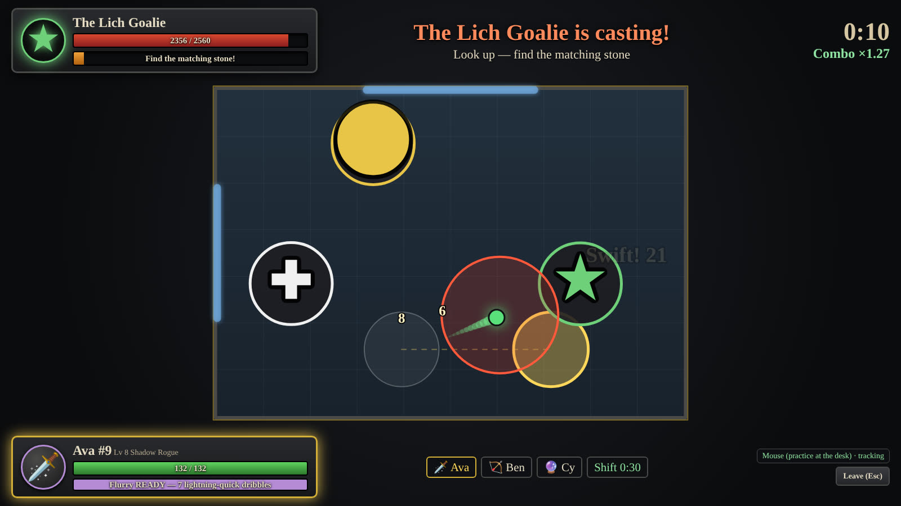
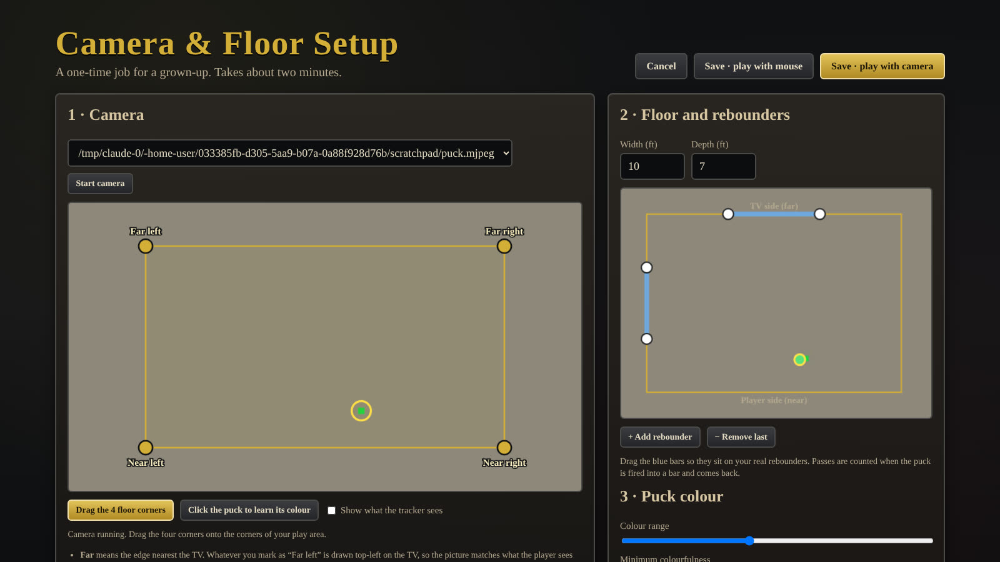

# Arcane Rink: Realm of the Puckbound

A Warcraft-style hockey practice game for a basement floor. An overhead camera tracks a
Green Biscuit puck; the TV shows a top-down map of the floor with quests, bosses and
dangers that exist only on screen. To play, you have to look up.

Built with Vite + TypeScript. No server, no accounts, works offline.



- **Plan, design and review of the first draft:** [docs/REALM_PLAN.md](docs/REALM_PLAN.md)
- **Original shooting-pad prototype:** still available at `/legacy.html`

## Run it

```bash
npm install
npm run dev      # then open the printed address in Chrome or Edge
npm test         # engine tests, including a bot that plays every encounter
npm run build
```

The camera needs `localhost` or https. Running the browser on the same computer that is
plugged into the TV and the camera is the simplest setup.

## What you need

- A clear patch of smooth floor (default 10 × 7 ft; any size works)
- A Green Biscuit (or any puck in a colour that stands out from the floor)
- A webcam mounted overhead or high on a wall, seeing the whole play area
- A TV the player can see while handling the puck
- Optional but recommended: one or more rebounders at the edge of the play area

## First-time setup

1. Open the game and choose **Camera & floor setup**.
2. **Start camera**, then drag the four gold corners onto the corners of the play area.
   "Far" is the edge nearest the TV.
3. Enter the play area's width and depth in feet.
4. Put the puck on the floor, choose **Click the puck to learn its colour**, and click it.
   It should be circled in yellow wherever you slide it.
5. Drag the blue bars in the top-down view onto your real rebounders.
6. **Save · play with camera.**



No camera handy? **Save · play with mouse** and the pointer stands in for the puck.

## How it plays

- Each kid creates a **hero** and picks a class: Blademaster (hard passes), Frost Mage
  (figure-eights), Shadow Rogue (fast hands) or Rune Ranger (give-and-go). Each hero has
  its own challenge tier, so different ages can share a party.
- **Quests** teach one stickhandling pattern each. **Dungeons** chain fights into a boss.
  The **raid** has the whole party taking 40-second shifts on one big boss.
- Bring the puck to the start circle to begin. Then do what the top of the screen says.
- Red circles, sweeping walls, hunting wisps and enemy spells only show on the TV.
  Keep your eyes up or get hit.
- Knocked down? Ten quick dribbles and you are back up.
- **The Five-Minute Vigil** is the daily routine with a streak counter.
- After each run a **practice report** shows touches, passes, clean catches, hardest pass
  and heads-up reactions.

Controls during play: `Space` skips the start circle, `P` pauses, `Esc` leaves.

## Status

The engine, tracking pipeline and screens are tested with automated players and a
synthetic camera feed. It has not yet been tuned with a real camera, puck and kids;
see the plan for what to adjust first.
