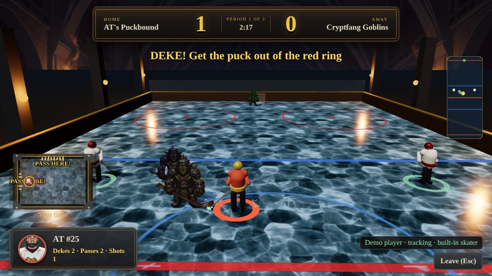
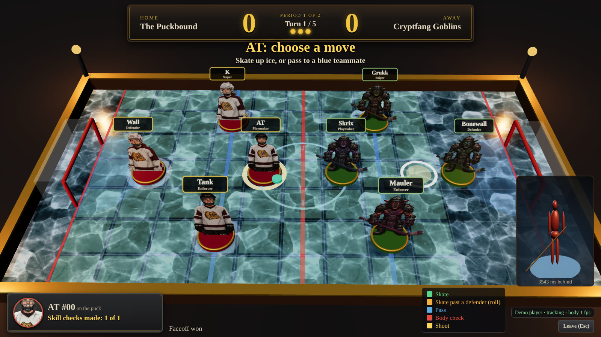

# Arcane Rink: Realm of the Puckbound

A fantasy hockey game you play with a real stick and puck on a basement floor.

There are three ways to play, all driven by the same puck tracking:

**Play hockey (real-time).** You are a skater on a full-size 3D rink, seen from behind.
Your patch of floor rides along with your skater: where the real puck sits on the floor
is where it sits at your skater's feet, and it steers.

| Do this with the real puck | In the game |
| --- | --- |
| Push it forward / pull it back | Skate faster / slower |
| Carry it left or right | Drift that way |
| Move it out of the red ring in time | Deke the goblin's poke-check |
| Pass off a **side** rebounder | Pass to a winger. Catch the rebound clean and you get it back: give-and-go |
| Pass off the **far** rebounder, in their zone | Shoot. Hit the left or right end of the rebounder to pick your corner |
| Lose it? | Puck battle: 8 quick dribbles to win it back before they break away |

Your skater is a built-in figure by default, and becomes **your tracked body** when the
body-tracking server is connected. Two 2½-minute periods.

**Coach a match (turn-based).** A fantasy sports board game in 3D: you coach four skaters
against the goblins on a rink of squares, and every dice roll (deke, pass, shot, body
check, faceoff) is earned with a few seconds of a real drill.

**Training quests.** Top-down fights against goblins that swing, charge, block and cast.





Built with Vite, TypeScript and three.js. Works offline apart from the optional body tracker.

- **Design, plan and what is tested:** [docs/REALM_PLAN.md](docs/REALM_PLAN.md)
- **Original shooting-pad prototype:** still available at `/legacy.html`

## Run it

```bash
npm install
npm run dev      # then open the printed address in Chrome or Edge
npm test         # engine tests, including a bot that plays every encounter
npm run build
```

The camera needs `localhost` or https. Running the browser on the same computer that is
plugged into the TV and the camera is the simplest setup.

## What you need

- A clear patch of smooth floor (default 10 × 7 ft; any size works)
- A Green Biscuit (or any puck in a colour that stands out from the floor)
- A webcam mounted overhead or high on a wall, seeing the whole play area
- A TV the player can see while handling the puck
- Optional but recommended: one or more rebounders at the edge of the play area

## First-time setup

1. Open the game and choose **Camera & floor setup**.
2. **Start camera**, then drag the four gold corners onto the corners of the play area.
   "Far" is the edge nearest the TV.
3. Enter the play area's width and depth in feet.
4. Put the puck on the floor, choose **Click the puck to learn its colour**, and click it.
   It should be circled in yellow wherever you slide it.
5. Drag the blue bars in the top-down view onto your real rebounders.
6. **Save · play with camera.**


No camera handy? **Save · play with mouse** and the pointer stands in for the puck.

## How a coached match plays

- Your team: Playmaker, Sniper, Enforcer, Defender. The kids' heroes are the first skaters, with their portraits.
- Each turn, three of your skaters may act. Slide the puck on the floor to move the
  cursor on the rink, and **hold it on a square** to choose it (a mouse click works too).
- Green squares: skate there. Amber: skate there, but you start next to a goblin, so you
  must roll a **deke**. Blue teammate: **pass**. Red goblin: **body check**. Gold net: **shoot**.
- Each roll shows the number needed. Then the drill starts and the die climbs from 1 as you perform:

| Roll | Drill |
| --- | --- |
| Deke | Dribble pad to pad as fast as you can |
| Body check | Wide, hard dribbles to build power |
| Pass | Pass off a rebounder and catch it clean |
| Shot | Rip it off a rebounder, hard and quick |
| Faceoff / Save | Wait for the drop, then get the puck to the rune first |

- A failed deke, pass or shot is a **turnover**: the goblins take over.
- When the goblins shoot, you get a **save** drill to take one off their roll.
- With more than one hero in the party, the game calls **TAG IN** each turn.
- Two periods. Choose a quick match (about 6 minutes) or a full one (about 12).

Want to see it first? Turn on **Watch it play itself** and press **Play a match**.

## Body tracking (optional)

This uses the Fast SAM 3D Body webcam server from the `3d-mesh-demo-webcam` repo.

1. Start that server on the GPU machine and forward its port as usual.
2. Start the game with the server's address: `BODY_SERVER=http://localhost:8098 npm run dev`
   (that address is the default). The game reaches it through its own `/body` path, so
   the server needs no changes.
3. Point a **second camera at the player** (on the TV works well). The overhead puck camera cannot see a body.
4. In the game: **Body tracking setup**, pick that camera, **Connect**, stand in view,
   look at the TV and press **I'm looking at the TV now**.

What you get: in **Play hockey** your body mesh is the skater on the rink; in a coached
match it is shown beside the die, and +1 is added to any roll where the head stayed up
for 70% of the drill. The server sends about 7 poses a
second, roughly 150 ms behind, which is why it drives the avatar and posture rather than fast play.

No GPU handy? `node tools/mock-body-server.mjs` stands in with a simple animated figure.

`tools/body-server-3d-joints.patch` is an optional change for that server: it adds 3D
joints to the stream, which lets the game draw a stick in the avatar's hands and measure
head angle more accurately. It has not been run against the model.

## Training quests

The first screen also has **Training quests**: real-time fights where the puck is a hero
and goblins swing, charge, block and cast. Quick dribbles strike, wide dribbles cleave, a
fast cut dashes through, a loop freezes, and a pass calls lightning. See the plan for details.

## Status

Verified here: automated tests of the match rules, drills, tracker and quest engine;
scripted players completing the real-time game, coached matches and quests in a real browser; the puck camera against a
synthetic video; the body-tracking client against the stand-in server.

Not yet tried: a real camera, a real puck, the real body-tracking server, or real kids.
Expect to tune colour thresholds, pass speeds and how many reps each die pip costs.
